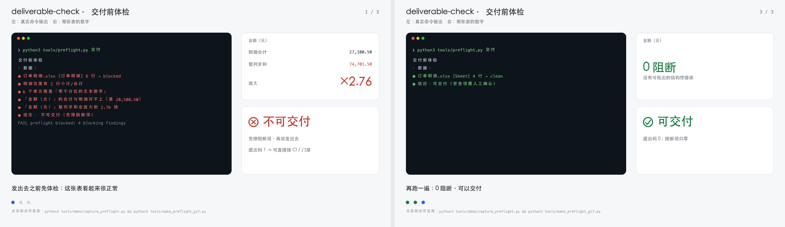

# deliverable-check · 交付前体检

> 三个体检工具，检查三类"看起来正常、其实错了"的交付物：
> **方案写得像不像样**、**稿子有没有 AI 味、改了多少轮**、**数据发出去之前算得对不对**。

全部是**可复跑的测量**，不是打分器。

[](docs/demo-preflight.gif)

<sub>**首屏是静图**（脏表被拦 / 修好后通过）；**点图看动图**（1320×768，约 0.9MB）。
左边的输出是真跑出来的，右边的 27,100.50 / 74,701.50 / ×2.76 也是真算出来的 —— 复跑：`python3 tools/demo/capture_preflight.py && python3 tools/make_preflight_gif.py`。</sub>

**一条命令跑完**（按文件类型自动分派）：

```bash
python3 tools/preflight.py 交付目录/ 方案.md
```

也可以作为 **Agent Skill** 安装（`SKILL.md` 已就位）：让 agent 在任何"发出去"的动作之前自动跑一次。

| 工具 | 回答什么问题 | 产出 |
|---|---|---|
| [`tools/measure_proposals.py`](tools/measure_proposals.py) | 这份方案有多少骨架、多少证据、多少断言？ | 结构/行文基线 JSON + [基线报告](docs/proposal-baseline.md) |
| [`tools/measure_ai_flavor.py`](tools/measure_ai_flavor.py) | 稿子哪些标记在退化？21 个版本到底改了什么？ | 标记密度 + [返工曲线](docs/ai-flavor.md) |
| [`tools/audit_data.py`](tools/audit_data.py) | 这个 Excel 发出去会不会被算错？ | 阻断/警告清单 + [体检报告](docs/data-audit.md)，`exit 1` 可接 CI |

---

> **同一套三件工具**（可单独用，也可以串起来）：
>
> - **[md-to-office](https://github.com/darkknight110/md-to-office)** —— 把 Markdown 变成能发出去的 Word/PDF（真框图、公文模板）
> - **[deliverable-check](https://github.com/darkknight110/deliverable-check)** —— 发出去之前体检：数据会不会被算错、方案骨架够不够
> - **[devflow-kit](https://github.com/darkknight110/devflow-kit)** —— 让「能不能发布」由门禁决定，而不是靠感觉
>
> 三个都是 MIT、本地运行；本文是 **deliverable-check** 的完整操作指南（安装 → 走一遍 → 排错）。

## 一行装好

```bash
pipx install git+https://github.com/darkknight110/deliverable-check.git
# 或者：uv tool install git+https://github.com/darkknight110/deliverable-check.git
# PyPI 首发后即可：pipx install deliverable-check
```

装完直接跑（不需要 `python` 前缀）：

```bash
preflight 交付/                     # 一个入口，按文件类型分派
audit-data 明细.xlsx --key-col 订单号
```

> 演示（GIF/故事板）另需 Pillow：`pip install "deliverable-check[demo] @ git+https://github.com/darkknight110/deliverable-check.git"`。

## 5 分钟走一遍（复制即用）

```bash
# 1) 装（可执行命令，不需要 python 前缀）
pipx install git+https://github.com/darkknight110/deliverable-check.git

# 2) 造一张"看起来正常、其实会算错"的脏表（30 秒看到效果）
make-dirty-sample --out /tmp/dirty.xlsx

# 3) 体检
preflight /tmp/dirty.xlsx
echo $?        # 期望 1
```

**期望看到**（数字来自真实计算，不是示例文案）：

```
⛔ 明细区里有 2 行小计/合计
⛔ 6 个单元格是「带千分位的文本数字」
⛔ 「金额（元）」整列求和会放大到 2.76 倍
结论：⛔ 不可交付（先修阻断项）
FAIL preflight blocked: 4 blocking findings
```

```bash
# 4) 换成你自己的交付物（文件或目录都行）
preflight 交付/                       # 按扩展名分派：.xlsx → 数据；.md/.docx → 方案
audit-data 明细.xlsx --key-col 订单号  # 单表深检，--json 可接 CI
```

**期望**：没有阻断时退出码 0；有阻断时 1。**退出码就是给门禁/CI 用的接口**，不需要解析文字。

### 排错

| 现象 | 原因 | 处理 |
|---|---|---|
| `ModuleNotFoundError: openpyxl` | 用系统 python 直接跑了脚本 | 用 `preflight` 命令；或 `pip install openpyxl` |
| `没有找到可体检的文件` | 路径指到空目录 | 指到具体文件，或确认交付目录里有 `.xlsx/.md/.docx` |
| 汇总表被说"放大 2 倍" | 汇总表本来就是明细+合计 | 已降级为提示，不需要改 |
| `合计与明细对不上` | 小计被算进明细，或合计行被人手改过 | 先看该列「明细合计 vs 合计行」，再决定改哪边 |
| 比率列没报错 | `GM %`、占比这类列不能求和 | 有意跳过，不是漏检 |

## 命令速查（三个工具）

```bash
# 1. 方案基线：量一批 Markdown
python3 tools/measure_proposals.py --out docs/proposal-baseline.json ../项目方案

# 2. AI 味与返工：量一个目录里的 .md/.docx（有版本号会自动串成版本链）
python3 tools/measure_ai_flavor.py --out docs/ai-flavor.json 某项目/导出

# 3. 数据体检：交付前跑一次，阻断即退出码 1
python3 tools/audit_data.py 交付表.xlsx --key-col 订单号
```

零第三方依赖？不完全是：`audit_data` 需要 `openpyxl`，其余两个只用标准库。

**已经接到流程里**：`audit_data.py` 可作为 devflow 门禁运行；声明 `release.requires` 后，
**数据没修好就发不出去**（released 前置阻断）。

新项目一条命令接好（devflow-kit ≥ 1.28.0）：

```bash
devflow init --with-preflight
```

它生成两个包装脚本、登记 `preflight` 门禁、加进 `release.requires`；负向对照会**现场造一张脏表**，
证明这道门禁不是恒真。

验收（两个脚本都是可复跑的）：

```bash
DEVFLOW=../devflow-kit/bin/devflow PREFLIGHT_HOME=.. bash examples/devflow-gate/verify-init.sh   # 一条命令接入：7/7
DEVFLOW=../devflow-kit/bin/devflow bash examples/devflow-gate/verify.sh                         # 手动接线：6/6
```

---

## 三个已量出来的结论

1. **方案的信息在表里**：34 份完整方案，中位 3,517 字 / 12 个二级章节 / **182 行表格** / 每千字 **82.5** 个数字；但只有 **32%** 写了验收指标、**6%** 写了报价。
2. **返工集中在前 30% 的版本**：一份设计方案改了 21 版、字数 +141%，前 6 次改动平均 5.1%，后 14 次只有 1.7%。第 8 版以后还在逐句润色，边际收益很低。
3. **"禁破折号"是错的**：21 个版本里破折号密度 **+49%**，而真正下降的是黑话密度（**−45%**）和句长（**−36%**）。判据要用数据校准，不能照搬。

---

## 数据体检能拦住什么

在一张"看起来正常"的脏表上（[可现场生成](tools/make_dirty_fixture.py)）：

```
⛔ 明细区里有 2 行小计/合计
⛔ 6 个单元格是「带千分位的文本数字」
⛔ 「金额（元）」整列求和会放大到 2.76 倍
⛔ 「金额（元）」的合计与明细对不上（差 20,500.50）
   结论：不可交付        （退出码 1）
```

而在真实的损益表上，它给出 **0 条阻断**（汇总表会降级为提示）——**不误报**和**不漏报**同样重要。

---

## 作为 Agent Skill 安装

把整个目录放进 agent 的技能根目录即可。两种装法：

```bash
# 全局（所有项目可用）
git clone https://github.com/darkknight110/deliverable-check.git ~/.dsh/skills/deliverable-check

# 只给当前项目（优先级更高，rank 100）
git clone https://github.com/darkknight110/deliverable-check.git .dsh/skills/deliverable-check
```

装好后，agent 在用户说「这个表能发吗」「这版方案能交吗」时会自动加载本技能，先跑 `preflight.py` 再回答。

## 测试

```bash
python3 -m unittest discover -s tests -v
```

37 个用例，覆盖：三类事故的检出、干净表不误报、比率列跳过、标记计数、版本排序与返工量。

---

## 边界

- 方案基线来自**自有语料**（6 个项目），不代表行业普遍水平；版本未去重。
- AI 味只给**可测信号**，不判断"像不像人"；经验层（真实细节）测不出来，只能靠人补。
- 数据体检只覆盖 `.xlsx`，只做可机械判定的检查，不替代业务口径评审。
- 三份文档的「边界」一节比结论更重要，建议先读那一节。

---

## 相关

- **[devflow-kit](https://github.com/darkknight110/devflow-kit)** —— 把"交付前必须过门禁"做成流程；本工具的 `exit 1` 可直接挂上去。
- **[md-to-office](https://github.com/darkknight110/md-to-office)** —— 方案最终要变成 Word/PDF，它负责排版与架构图替换。

MIT。
